  

  <b>Distinguished Engineer @ Walmart Global Tech</b> · AI Plumber · Polyglot builder 
  San Francisco Bay Area

  

  
  
  

---

### About me

Principal Engineer and AI/ML Architect with **17+ years** building large-scale distributed systems, cloud-native platforms and AI-powered products across **AdTech, Retail, Payments, Big Data and Machine Learning**.

- Leading **GenAI and AI platform** work at Walmart: autonomous agent frameworks ("Super Agents"), recommendation systems and enterprise AI adoption
- Built media analytics, attribution and **Marketing Mix Modeling** platforms that help advertisers measure impact and spend smarter
- Happiest in the gap between research and production: turning new AI ideas into systems that run at massive scale
- Right now: [**Ship 100**](https://github.com/August85/ship100), one product a day for 100 days
- I enjoy mentoring teams, solving hard engineering problems and learning new stacks fast

---

### Highlights

| | |
|---|---|
| **Distinguished Engineer**, Walmart Global Tech | Promoted Sept 2026 after Staff → Principal roles in India and the US |
| **AI agent frameworks** | Architect of "Super Agents" bringing agentic automation across multiple B2B platforms |
| **Cloud migration at scale** | Moved on-prem data platforms to GCP/Azure with high-volume, event-driven pipelines |
| **Deep learning on Spark** | Built a distributed *build → train → deploy* framework for ML models with Spark + TensorFlow |
| **NLP engines** | Product categorization and attribution engines for online retail giants |
| **Golden Pyramid Award** | Recognized at Ugam for technical contribution |
| **Community** | Speaker at the [Bangalore AI/ML Meetup](https://github.com/August85/TechMeet-3rdFeb-2018) |

---

### What I work with

**Generative AI & ML**

  
  
  
  
  
  
  
  
  
  
  
  

**Big Data & Streaming**

  
  
  
  
  
  
  
  

**Languages, cloud & full stack**

  

---

### Things I've built lately

| Project | What it is | Stack |
|---|---|---|
| [**Ship 100**](https://github.com/August85/ship100) | One product a day for 100 days, with a public tracker | JS · iOS · Garmin · Pi |
| [**Pathgraph**](https://pathgraph.ai) | See the career paths people took from where you are today | Next.js · TypeScript |
| [**ArchiQuest**](https://github.com/August85/ArchiQuest) | Browser game: fix broken system architectures, then watch the traffic replay | TypeScript |
| [**WealthPilot**](https://github.com/August85/WealthPilot) | Cross-border (US–India) financial planning: net worth, RSUs, 401(k), EPF, retirement | TypeScript |
| [**SpeedRead**](https://github.com/August85/SpeedRead) | iPhone app for fast reading, one word at a time | Swift |
| [**WristVault**](https://github.com/August85/wristvault) | Private iPhone app for watch collectors | SwiftUI |
| [**LevelUP**](https://github.com/August85/levelup) | Installable web app: an engineering knowledge library and AI reading feed | HTML · JS |
| [**Garmin watch faces**](https://github.com/August85/garmin-watchfaces) | Custom faces for Garmin watches | Monkey C |
| [**katyayan.net**](https://katyayan.net) | My personal portal | React · FastAPI · AWS |

---

### Beyond code

- **Speedcuber:** I solve the Rubik's Cube, with a personal best under 20 seconds
- **Guitarist:** I play guitar when I'm away from the keyboard
- **Reader:** I'm an avid reader of Hindi literature
- **Future author:** one day I want to write books of my own

---

### Career path

  

### Certifications

Improving Deep Neural Networks · Convolutional Neural Networks · Structuring Machine Learning Projects · GCP Big Data and Machine Learning Fundamentals · A Crash Course in Data Science

---

  

<i>Always happy to talk about AI agents, distributed systems, or your next side project.</i>

